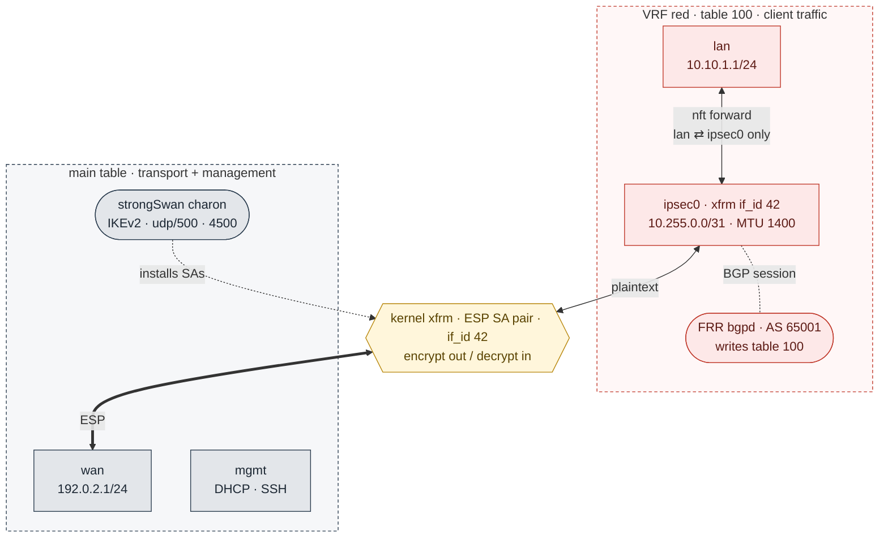
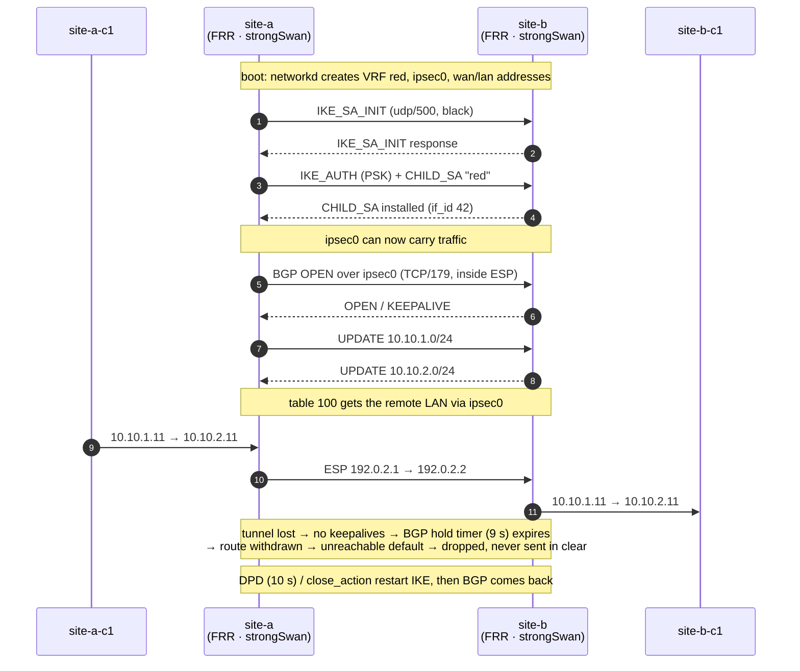

# NixOS router appliances

One generic NixOS image boots on every router. Each site's configuration is then pushed to the running box with `nixos-rebuild --target-host`, with no reimaging. This repo also has a lab that runs two routers as QEMU VMs on an Apple Silicon Mac, puts Docker clients behind them, and checks the whole path end to end.

```mermaid
flowchart LR
    subgraph LANA["site-a LAN · 10.10.1.0/24"]
        direction TB
        a1["site-a-c1<br/>10.10.1.11"]
        a2["site-a-c2<br/>10.10.1.12"]
    end

    subgraph RA["router site-a · AS 65001"]
        direction LR
        subgraph REDA["red · VRF table 100"]
            direction TB
            frrA(["FRR bgpd"])
            lanA["lan<br/>10.10.1.1/24"]
            ipsecA["ipsec0<br/>10.255.0.0/31"]
        end
        subgraph BLKA["black · main table"]
            wanA["wan<br/>192.0.2.1"]
        end
    end

    subgraph RB["router site-b · AS 65002"]
        direction LR
        subgraph BLKB["black · main table"]
            wanB["wan<br/>192.0.2.2"]
        end
        subgraph REDB["red · VRF table 100"]
            direction TB
            frrB(["FRR bgpd"])
            ipsecB["ipsec0<br/>10.255.0.1/31"]
            lanB["lan<br/>10.10.2.1/24"]
        end
    end

    subgraph LANB["site-b LAN · 10.10.2.0/24"]
        direction TB
        b1["site-b-c1<br/>10.10.2.11"]
        b2["site-b-c2<br/>10.10.2.12"]
    end

    a1 & a2 --- lanA
    lanA -- "forward" --> ipsecA
    ipsecA -- "xfrm if_id 42" --> wanA
    wanA <== "IKEv2 + ESP · AES-256-GCM" ==> wanB
    wanB -- "xfrm if_id 42" --> ipsecB
    ipsecB -- "forward" --> lanB
    lanB --- b1 & b2
    frrA <-. "eBGP via ipsec0 · hold 9 s" .-> frrB

    classDef red fill:#fde8e8,stroke:#c0392b,color:#5c1a14
    classDef black fill:#e3e6ea,stroke:#2c3e50,color:#1c2733
    classDef host fill:#eaf3ff,stroke:#2f6fb3,color:#163a5f
    class lanA,frrA,ipsecA,lanB,frrB,ipsecB red
    class wanA,wanB black
    class a1,a2,b1,b2 host
    style RA fill:#ffffff,stroke:#8a94a3
    style RB fill:#ffffff,stroke:#8a94a3
    style LANA fill:#f5f9ff,stroke:#2f6fb3,stroke-dasharray:4 3
    style LANB fill:#f5f9ff,stroke:#2f6fb3,stroke-dasharray:4 3
    style REDA fill:#fff7f7,stroke:#c0392b,stroke-dasharray:4 3
    style REDB fill:#fff7f7,stroke:#c0392b,stroke-dasharray:4 3
    style BLKA fill:#f6f7f9,stroke:#2c3e50,stroke-dasharray:4 3
    style BLKB fill:#f6f7f9,stroke:#2c3e50,stroke-dasharray:4 3
```



Red (client traffic) and black (the wan) never share a routing table: red can only leave through `ipsec0`, so it is encrypted or dropped. Each router also has a `mgmt` port (DHCP + SSH) in the main table, which is where `./deploy.sh` pushes configs.

## How it works

| Layer | File | Owned by | Changes need |
|---|---|---|---|
| OS, bootloader, mgmt + SSH, store housekeeping | [`modules/base.nix`](modules/base.nix) | platform | new image (or a push) |
| Port map for one hardware model | [`hardware/qemu-virt.nix`](hardware/qemu-virt.nix) | platform | new image (or a push) |
| Disk-image layout | [`modules/image.nix`](modules/image.nix) | platform | new image |
| Router function: VRF, IPsec, BGP, firewall | [`modules/router.nix`](modules/router.nix) | network team | push |
| Per-site values (`router.*`) | [`sites/<name>.nix`](sites) | site team | push |

[`flake.nix`](flake.nix) puts these together:

- `nixosConfigurations.base` is `base.nix` + hardware + admin keys + `image.nix`. It has no site config: hostname `router-unprovisioned`, DHCP and SSH on `mgmt`, nothing else.
- `nixosConfigurations.<site>` is generated for every `sites/*.nix`, and is `base.nix` + hardware + admin keys + `router.nix` + that site file.
- `packages.aarch64-linux.base-image` is the bootable disk image built from `base`.
- `devShells.aarch64-darwin.default` gives the Mac `nixos-rebuild` and `qemu`, pinned to the flake's nixpkgs.

### The router design (`modules/router.nix`)

- **Red/black separation.** `lan` and `ipsec0` live in VRF `red` (table 100). `wan` and `mgmt` stay in the main table. Red traffic can only leave through `ipsec0`, an xfrm interface that carries only traffic strongSwan has encrypted.
- **Fail-closed.** VRF red has an `unreachable 0.0.0.0/0` at the lowest priority, so unknown destinations are dropped instead of falling through to the main table. If the tunnel goes down, BGP (3 s keepalive / 9 s hold) withdraws the remote prefix and red traffic has no route left.
- **No route to the router itself from red.** The kernel's `lookup local` rule (pref 0) is moved to pref 32765, after the VRF rule. Without this, red clients could reach the router's wan and mgmt addresses. The `vrf-local-rule` service deletes the original rule.
- **IPsec.** IKEv2 with AES-256-GCM and ECP-384. It is route-based: SAs are bound to `ipsec0` with `if_id 42`, and strongSwan installs no routes, so FRR owns routing. Both sides initiate and restart on DPD.
- **Firewall (nftables).** The wan accepts only IKE (udp/500, 4500) and ESP. BGP is accepted only from `ipsec0`/`red`. Forwarding is allowed only between `lan` and `ipsec0`, matched on `sdifname` because inside a VRF the forward hook sees `iif = red`.

### Port naming

Interfaces are renamed to `mgmt`, `wan` and `lan` by udev bus position (`ID_NET_NAME_PATH`), in both the initrd and stage 2. In QEMU, PCI slot `0x3` is mgmt, `0x4` is wan and `0x5` is lan. Each physical hardware model gets its own `hardware/<model>.nix`. Find the path names on new hardware with:

```bash
udevadm info /sys/class/net/<if> | grep ID_NET_NAME_PATH
```

## Physical vs logical design

The routers can be described at two levels. The **physical** level is the ports and cables: what plugs into what. The **logical** level is what runs on top of those ports: routing tables, the tunnel and the routing protocol. Only the hardware port map ([`hardware/*.nix`](hardware)) knows about the physical level. Everything in [`modules/router.nix`](modules/router.nix) works with the logical names `mgmt`, `wan` and `lan`.

### Physical: the lab on one Mac

A real appliance has three Ethernet ports. In the lab, each port is a virtio NIC in a fixed PCI slot, connected by a different QEMU backend:

```mermaid
flowchart LR
    subgraph DA["Docker Desktop · site-a LAN"]
        direction TB
        ca["site-a-c1 · c2<br/>10.10.1.11 · .12"]
        swa["site-a-lan switch<br/>br0 ⇄ tap0 ⇄ socat"]
    end
    subgraph VA["QEMU VM site-a"]
        direction TB
        a5["0x5 · lan"]
        a4["0x4 · wan"]
        a3["0x3 · mgmt"]
    end
    host{{"macOS host<br/>user-mode NAT → internet<br/>ssh 127.0.0.1:2221 · 2222"}}
    subgraph VB["QEMU VM site-b"]
        direction TB
        b5["0x5 · lan"]
        b4["0x4 · wan"]
        b3["0x3 · mgmt"]
    end
    subgraph DB["Docker Desktop · site-b LAN"]
        direction TB
        cb["site-b-c1 · c2<br/>10.10.2.11 · .12"]
        swb["site-b-lan switch<br/>br0 ⇄ tap0 ⇄ socat"]
    end

    ca -- veth --- swa
    swa <-- "UDP 12001 ⇄ 11001" --> a5
    a4 <== "QEMU socket · 127.0.0.1:10001<br/>(virtual cable)" ==> b4
    a3 <-. "hostfwd :2221 → :22" .-> host
    host <-. "hostfwd :2222 → :22" .-> b3
    b5 <-- "UDP 11002 ⇄ 12002" --> swb
    swb -- veth --- cb

    classDef port fill:#e3e6ea,stroke:#2c3e50,color:#1c2733
    classDef red fill:#fde8e8,stroke:#c0392b,color:#5c1a14
    classDef cl fill:#eaf3ff,stroke:#2f6fb3,color:#163a5f
    classDef ext fill:#fff6db,stroke:#b8860b,color:#5a4300
    class a3,a4,b3,b4 port
    class a5,b5,swa,swb red
    class ca,cb cl
    class host ext
    style VA fill:#f6f7f9,stroke:#2c3e50
    style VB fill:#f6f7f9,stroke:#2c3e50
    style DA fill:#f5f9ff,stroke:#2f6fb3,stroke-dasharray:4 3
    style DB fill:#f5f9ff,stroke:#2f6fb3,stroke-dasharray:4 3
```



| Port | PCI slot | Lab backend | On real hardware |
|---|---|---|---|
| `mgmt` | `0x3` | QEMU user-mode NAT. DHCP gives `10.0.2.15`, and host ports 2221/2222 forward to SSH. | Out-of-band management network |
| `wan` | `0x4` | One QEMU socket backend per VM: site-a listens and site-b connects, which acts like a cable between the two. Both wans sit on `192.0.2.0/24` with no gateway. | Uplink to the ISP or transport network |
| `lan` | `0x5` | A UDP frame pipe to a switch container inside Docker Desktop. That container bridges the frames onto the clients' veth interfaces. | The site's access switch |

The VMs and the Docker containers run in different VMs with no shared Ethernet, which is why `lan` needs the UDP pipe and the switch container (see [`lab/lan.sh`](lab/lan.sh)). Inside the router none of this is visible: the router only sees three NICs, and the hardware profile names them.

### Logical: inside one router

Each router splits its ports into two routing domains that never share a routing table:



- **Red** (VRF `red`, table 100) holds `lan` and `ipsec0`. FRR runs here, and only here.
- **Black** (the main table) holds `wan` and `mgmt`. strongSwan's IKE traffic and SSH live here.
- The two meet only in the kernel's **xfrm** layer. A packet routed out of `ipsec0` is encrypted with the SA tagged `if_id 42` and leaves on `wan` as ESP. Decrypted ESP that arrives on `wan` comes back in on `ipsec0`.

The kernel's policy rules decide which table a packet is looked up in:

| Pref | Rule | Effect |
|---|---|---|
| 1000 | `l3mdev` (added by the kernel for VRFs) | Packets on `lan`/`ipsec0` use table 100 |
| 32765 | `lookup local` (moved here from pref 0) | Only reached by non-VRF traffic, so red can't reach the router's own wan/mgmt addresses |
| 32766 | `lookup main` | Black traffic |

Table 100 ends in `unreachable 0.0.0.0/0`, so a red packet with no specific route is dropped instead of falling through to the main table.

### How it stacks: IPsec first, BGP on top

This is **not BGP EVPN**. There is no VXLAN and no MAC/IP advertisement. It is a layer-3 overlay: **plain eBGP, IPv4 unicast, inside VRF red, carried through a route-based IPsec tunnel.** The layers, bottom to top:

| Layer | What | Where it's configured |
|---|---|---|
| 4 · Client traffic | `10.10.1.0/24` ⇄ `10.10.2.0/24` | `sites/*.nix` (`router.lan`) |
| 3 · Routing | eBGP between `10.255.0.0` and `10.255.0.1`, which advertises each site's LAN prefix into table 100 | `services.frr` |
| 2 · Tunnel interface | `ipsec0`, an xfrm interface in VRF red with a `/31` link network | `systemd.network.netdevs."30-ipsec0"` |
| 1 · Encryption | IKEv2 SA plus an ESP CHILD_SA (tunnel mode, AES-256-GCM, `0.0.0.0/0 ⇄ 0.0.0.0/0`) bound to `if_id 42` | `services.strongswan-swanctl` |
| 0 · Transport | `wan` ⇄ `wan` on `192.0.2.0/24` | `router.wan` + hardware profile |

**IPsec comes up first, and BGP depends on it.** The BGP neighbour `10.255.0.1` is on the far end of `ipsec0`. The BGP TCP session is itself red traffic, so it is encrypted like everything else. Until the CHILD_SA exists, packets routed into `ipsec0` match no SA and are dropped. The BGP session can't establish, no remote prefix is installed, and clients have no path to the other site.



Both sides initiate (`start_action = start`), and `unique = replace` keeps a single IKE SA. FRR needs no special ordering: it keeps retrying the neighbour until the tunnel is there.

### A packet's path, site-a to site-b

```mermaid
flowchart LR
    c["site-a-c1<br/>10.10.1.11 → 10.10.2.11"]
    l["in on lan<br/>(VRF red)"]
    r["ip rule 1000 l3mdev<br/>→ table 100"]
    rt["10.10.2.0/24<br/>via 10.255.0.1 dev ipsec0<br/>(learned by BGP)"]
    fw["nft forward<br/>sdifname lan → oif ipsec0 ✓"]
    x["xfrm out, if_id 42<br/>ESP encrypt"]
    m["outer 192.0.2.1 → 192.0.2.2<br/>main table → wan"]
    c --> l --> r --> rt --> fw --> x --> m

    classDef red fill:#fde8e8,stroke:#c0392b,color:#5c1a14
    classDef black fill:#e3e6ea,stroke:#2c3e50,color:#1c2733
    classDef k fill:#fff6db,stroke:#b8860b,color:#5a4300
    classDef host fill:#eaf3ff,stroke:#2f6fb3,color:#163a5f
    class c host
    class l,r,rt,fw red
    class x k
    class m black
```



On the wan this packet is one outer IP header and ESP. The client addresses and payload are inside the encrypted part, which is what `lab/test.sh` checks with `tcpdump`:

| Header | Visible on wan? | Contents |
|---|---|---|
| Ethernet | yes | wan MACs |
| Outer IPv4 | yes | `192.0.2.1 → 192.0.2.2`, protocol 50 (ESP) |
| ESP header | yes | SPI and sequence number |
| Inner IPv4 | **no**, encrypted | `10.10.1.11 → 10.10.2.11` |
| TCP/ICMP and payload | **no**, encrypted | e.g. the app's reply `site-b-c1` |

The same applies to BGP: its TCP/179 packets between `10.255.0.0` and `10.255.0.1` are inner packets as well, so routing information never crosses the wan in the clear. `ipsec0`'s MTU of 1400 leaves room for the ESP and outer IP overhead.

> **If you want EVPN later:** it would be a new layer between 2 and 3. Each site would get a VTEP (VXLAN), the BGP session would carry the `l2vpn evpn` address family, and the VXLAN packets would be routed through `ipsec0`. The IPsec layer, the VRF separation and the fail-closed behaviour would all stay as they are. The cost is a smaller MTU, because of the extra 50 bytes of VXLAN overhead.

> **Running on Linux KVM** (router VM plus a Kubernetes VM in red): see [`docs/kvm-linux.md`](docs/kvm-linux.md) for the changes needed and the network design.

## Building the router image with Nix

The image is a UEFI raw disk built with NixOS's `systemd-repart` image builder ([`modules/image.nix`](modules/image.nix)):

| Partition | Contents |
|---|---|
| `10-esp` (vfat, label `ESP`, 512 MB) | `systemd-boot` as the removable-media loader (`/EFI/BOOT/BOOTAA64.EFI`), plus a **factory UKI** in `/EFI/Linux/`. `systemd-boot` finds the UKI on its own. Later `nixos-rebuild` generations are added next to it, so the factory entry stays as a last-resort fallback. |
| `20-root` (ext4, label `nixos`) | The closure of the base system, plus `/nix-path-registration`. The partition is minimized at build time. |

On first boot:

1. `systemd-repart` in the initrd grows the root partition to fill the disk, and `autoResize` grows the filesystem.
2. `nix-load-db` registers the image's store paths with Nix from `/nix-path-registration`, then deletes that file. Without this step, Nix on the router wouldn't know about the paths already on disk, and pushes would fail or download everything again.

`systemd-repart` doesn't need a VM or KVM, so the image builds in a privileged Docker container. The image targets `aarch64-linux`. On an Apple Silicon Mac, Docker Desktop runs the `nixos/nix` container natively, so nothing is emulated.

```bash
docker run --rm --privileged -v router-nix-store:/nix -v "$PWD":/work -w /work \
  -e NIX_CONFIG=$'experimental-features = nix-command flakes\nsandbox = true' \
  nixos/nix:latest sh -c 'git config --global --add safe.directory /work &&
    nix build .#base-image --out-link /tmp/base && mkdir -p out && cp -L /tmp/base/*.raw out/'
```

This writes `out/router-base.raw` (about 2.6 GB). The `router-nix-store` volume caches the builder's `/nix`, so rebuilds take about 2 minutes. A cold build downloads FRR, strongSwan, the kernel and the rest first.

If you're on an `aarch64-linux` machine that has Nix, you can build directly with `nix build .#base-image`.

> **Nix only sees files tracked by git.** Run `git add` on any new file (a new `sites/*.nix`, for example) before you build or deploy. Keep this folder a git repo. Without git, Nix copies the whole directory, including `out/` and the VM disks, into the store on every evaluation.

## Prerequisites

- An Apple Silicon Mac. The VMs use `-accel hvf`, and the dev shell is `aarch64-darwin`.
- Nix with flakes. The scripts pass `--extra-experimental-features` themselves.
- Docker Desktop, for the image builder and the lab LANs.
- The lab SSH key at `lab/lab-key`. It's gitignored, and its public half is [`keys/lab-admin.pub`](keys/lab-admin.pub), which is baked into the image. On a fresh clone, create a new pair and rebuild the image:

  ```bash
  ssh-keygen -t ed25519 -N '' -C router-lab-admin -f lab/lab-key
  mv lab/lab-key.pub keys/lab-admin.pub
  ```

## Spinning up the lab

Run everything from the repo root.

**1. Build the base image** as shown above, so that `out/router-base.raw` exists.

**2. Enter the dev shell**, which provides `qemu-system-aarch64`, `qemu-img` and the edk2 firmware:

```bash
nix develop
```

**3. Boot two routers from the same image.** Each VM gets a copy-on-write qcow2 disk on top of the raw image, so `out/router-base.raw` is never changed. Start `site-a` first, because it listens on the wan socket that `site-b` connects to.

```bash
lab/vm.sh start site-a 2221 listen=127.0.0.1:10001
lab/vm.sh start site-b 2222 connect=127.0.0.1:10001
```

The SSH ports must be `2221` and `2222`. They match [`lab/ssh_config`](lab/ssh_config), and `lab/vm.sh` derives the VM index (1, 2) from them, which `lab/lan.sh` uses. Serial output goes to `lab/vms/<site>.console`. Wait until SSH answers:

```bash
ssh -F lab/ssh_config site-a hostname     # prints router-unprovisioned
```

**4. Push the site configs:**

```bash
./deploy.sh                       # switch every site in sites/, in parallel
./deploy.sh switch site-a         # only one site
./deploy.sh test site-a site-b    # apply live; a reboot returns to the previous generation
./deploy.sh dry-activate          # show what would restart, change nothing
```

`deploy.sh` runs `nixos-rebuild <action> --flake .#<site> --target-host root@<site> --build-host root@<site>`. The Mac only evaluates the configuration, and each router builds its own system, getting packages through its `mgmt` NAT. If `nixos-rebuild` isn't on your PATH, the script re-runs itself inside `nix develop`. It also uses `lab/ssh_config` automatically when that file exists, so site names resolve to the local VMs. In a real fleet, site names are ordinary SSH hosts.

**5. Attach a LAN of Docker clients to each router:**

```bash
lab/lan.sh up site-a 10.10.1 1    # site-a-c1 10.10.1.11, site-a-c2 10.10.1.12, gw 10.10.1.1
lab/lan.sh up site-b 10.10.2 2
```

Each `<site>-lan` container is a bridge with a tap device. `socat` pipes Ethernet frames between that tap and the VM's `lan` NIC over UDP (`127.0.0.1:11000+n` ↔ `:12000+n`), because the QEMU VMs and the Docker VM share no network. Clients answer on tcp/80 with their hostname.

**6. Run the end-to-end checks:**

```bash
lab/test.sh            # reachability, encryption on the wire, isolation, fail-closed, recovery
lab/test.sh --reboot   # also reboot site-a and confirm it comes back on the pushed generation
```

The checks cover:
- BGP routes on both sides, plus pings and app traffic across the tunnel.
- A `tcpdump` on site-b's wan that must see ESP and must not see any `10.10.x` address or app payload.
- Red clients must not reach the wan addresses, the router's mgmt address, the internet, or SSH on the router.
- With strongSwan stopped on site-a, routes are withdrawn and nothing leaks in the clear. When it starts again, traffic recovers.

## Tearing down

**Stop the lab but keep the image** (the usual case):

```bash
lab/lan.sh down site-a; lab/lan.sh down site-b      # switch + client containers
lab/vm.sh destroy site-a; lab/vm.sh destroy site-b  # stop VM, delete its qcow2 and console log
```

`lab/vm.sh stop <site>` stops a VM but keeps its disk, so the next `start` resumes with the pushed config.

**Reclaim all the disk space** once you're done testing:

```bash
docker rmi router-lab-switch:local                         # lan.sh rebuilds it on demand
rm -rf out                                                 # base image, ~2.6 GB
docker volume rm router-nix-store && docker rmi nixos/nix:latest   # builder cache, ~6.8 GB
nix-collect-garbage                                        # Mac store: dev shell, nixpkgs source
```

`nix-collect-garbage` collects **every** unreferenced path in the Mac's store, not just this project's. After it runs, the first `nix develop` or `./deploy.sh` downloads QEMU and `nixos-rebuild` again.

**Sweep for leftovers:**

```bash
docker ps -a --filter name=site-                           # should be empty
ls -d /tmp/nix-shell.* /tmp/nixos-rebuild.* 2>/dev/null    # nix develop / deploy leftovers
ls lab/vms 2>/dev/null                                     # should be empty or absent
```

`out/`, `lab/vms/` and `lab/lab-key` are gitignored, so `git status` won't show them. Delete `lab/lab-key` when you retire the lab.

## Adding a site

1. Copy `sites/site-a.nix` to `sites/<name>.nix` and set the `router.*` values (options are documented in [`modules/router.nix`](modules/router.nix)).
2. Run `git add sites/<name>.nix`. The flake only sees tracked files.
3. Make `<name>` resolvable over SSH as `root`, then run `./deploy.sh switch <name>`.

The topology is currently point-to-point: one peer per site (`router.tunnel.*`).

## Day-2 behaviour on the routers

- `systemd-boot` keeps the last 5 generations in the boot menu, and the factory UKI stays as a fallback. Roll back with `nixos-rebuild --rollback` or by picking an older entry at boot.
- Nix GC runs weekly (with a random delay of up to 1 h, catching up after downtime) and deletes generations older than 30 days. Nix also collects on its own when free space drops below 1 GiB, until 3 GiB is free. Store optimisation runs weekly.
- SSH is key-only (`PermitRootLogin prohibit-password`), is reachable only on `mgmt`, and `users.mutableUsers = false`.

## Lab-only shortcuts — fix before production

- **The pre-shared key is in the site files** (`router.tunnel.psk`), so it ends up world-readable in `/nix/store`. Use certificates, or a runtime secret such as sops-nix or agenix.
- **`keys/lab-admin.pub` is the only admin key**, and it's set in `flake.nix`. Replace it with real operator keys.
- `lab/ssh_config` disables host-key checking.
- `base.nix` imports the `qemu-guest` profile. That belongs in `hardware/qemu-virt.nix` once there's a physical hardware model.
- The lab images are unpinned (`alpine:latest`, `ghcr.io/srl-labs/clab:latest`, `nixos/nix:latest`).

## Repository layout

```
flake.nix               configurations, base-image package, Mac dev shell
modules/base.nix        shared OS: boot, mgmt, SSH, GC
modules/image.nix       systemd-repart disk image (base only)
modules/router.nix      VRF + IPsec + BGP + firewall, configured via router.*
hardware/qemu-virt.nix  NIC slot -> mgmt/wan/lan names
sites/*.nix             one file per site
keys/lab-admin.pub      admin key baked into the image
deploy.sh               parallel nixos-rebuild to sites
lab/vm.sh               QEMU/HVF router VMs on the Mac
lab/lan.sh              Docker client LANs bridged to the VMs
lab/lan/Dockerfile      the LAN switch container
lab/test.sh             end-to-end checks
lab/ssh_config          site name -> local VM port
note.md                 storage/cleanup notes from the last lab run
docs/kvm-linux.md       design: Linux KVM host, router VM + k8s VM
```
