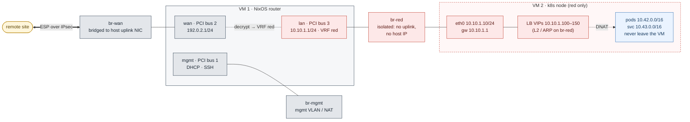

# Running on a Linux KVM host

> **Status: design, not yet implemented or tested.** Today the repo targets an Apple Silicon Mac: QEMU with HVF for the lab, and a Docker container to build the image. This document describes the code changes needed to run on a Linux KVM host, and the network design for running the router next to a Kubernetes VM.

The target setup is one KVM host running two VMs:

- **VM 1, the NixOS router** from this repo, booted from the base image and configured with `./deploy.sh`.
- **VM 2, a Kubernetes node**, which sits in the red network behind the router. Its services are reachable from other sites over the IPsec tunnel. Its pods are never routable.

## Topology



The two VMs connect through `br-red`, a Linux bridge on the host that has no IP address and no physical uplink. It works as a private switch between the router's `lan` port and the k8s VM, so the only way out of red is through the router and its tunnel.

## Part 1: code changes for Linux KVM

Most of the stack carries over unchanged. The router modules, the site files, `lab/test.sh`, `lab/ssh_config` and the deploy flow all stay the same. What changes is the CPU architecture, how VMs are started, and how the LAN is wired.

### 1.1 CPU architecture (`flake.nix`)

`flake.nix` hardcodes `system = "aarch64-linux"`, and the dev shell exists only for `aarch64-darwin`. KVM only accelerates guests of the host's own architecture, so on an x86 server, arm64 routers would run under full emulation (QEMU TCG), which is very slow.

- Set `system` to the host's architecture, or make it a parameter so the same flake can produce both.
- Add dev shells for Linux:

  ```nix
  devShells = lib.genAttrs [ "aarch64-darwin" "x86_64-linux" "aarch64-linux" ] (s:
    let p = nixpkgs.legacyPackages.${s}; in {
      default = p.mkShell { packages = [ p.nixos-rebuild p.qemu ]; };
    });
  ```

### 1.2 Hardware profile is now a choice (`flake.nix`, `hardware/`)

`hardware/qemu-virt.nix` is currently part of `common`, so every configuration gets the lab's port map. The KVM host needs its own port map (section 2.2), so the hardware profile has to become a per-image choice. Two ways to do it:

- one base image per hardware model, such as `base-qemu-virt` and `base-kvm-q35`, each with its own `hardware/*.nix`; or
- a `hardware` attribute per site, so `nixosConfigurations.<site>` picks the matching profile.

The port names only exist once the profile renames the NICs. So the profile used to build the base image must match the hardware the image boots on, and the site config pushed later must use the same profile.

### 1.3 Serial console (`modules/base.nix`)

`console=ttyAMA0` is the arm64 PL011 UART. On x86 it is `ttyS0`. Choose it by architecture:

```nix
boot.kernelParams = [ "console=tty0" ]
  ++ (if pkgs.stdenv.hostPlatform.isAarch64 then [ "console=ttyAMA0" ] else [ "console=ttyS0,115200" ]);
```

Without this, the router's boot log never reaches `virsh console` or the lab's console file.

`profiles/qemu-guest.nix` (virtio drivers) stays correct for KVM. Physical hardware is where it would move into the hardware profile.

### 1.4 Building the image

On a Linux host with Nix installed, build directly. The Docker builder container and its `router-nix-store` volume aren't needed.

```bash
nix build .#base-image
cp -L result/*.raw /var/lib/libvirt/images/router-base.raw
```

`modules/image.nix` already chooses the EFI file names by architecture (`BOOTX64.EFI` / `systemd-bootx64.efi` on x86), so it needs no change.

### 1.5 Lab VM launcher (`lab/vm.sh`)

This applies only if you keep the script-driven lab on a Linux machine. For the two-VM deployment, use libvirt instead (Part 2).

| Now (Mac) | x86 KVM host | arm64 KVM host |
|---|---|---|
| `qemu-system-aarch64` | `qemu-system-x86_64` | unchanged |
| `-machine virt,accel=hvf` | `-machine q35,accel=kvm` | `-machine virt,accel=kvm` |
| `edk2-aarch64-code.fd` | `edk2-x86_64-code.fd` (also shipped with QEMU) | unchanged |

`-cpu host` stays. The user running it needs access to `/dev/kvm`, usually by being in the `kvm` group. With plain QEMU, the NICs at `addr=0x3/0x4/0x5` sit on the root bus, so they should keep their `enp0s3/4/5` names and `hardware/qemu-virt.nix` still applies. Check with `udevadm`, as shown in section 2.2.

### 1.6 Lab LAN wiring (`lab/lan.sh`)

The socat switch container and UDP frame pipe exist only because QEMU on macOS and Docker Desktop's VM share no Ethernet. On Linux they also break as written:

- `host.docker.internal` doesn't resolve by default;
- QEMU listens on `127.0.0.1`, which containers can't reach.

On Linux, use host bridges directly:

```
router VM lan NIC ── tap (-netdev bridge,br=br-site-a-lan) ── br-site-a-lan ── veth ── client container
```

- `lan.sh up` creates the bridge and plugs each client's veth into it on the host. The switch container goes away.
- `vm.sh` attaches the lan NIC with `-netdev bridge,br=br-<site>-lan`. That needs root or `qemu-bridge-helper`, with the bridge allowed in `/etc/qemu/bridge.conf`.
- `lab/lan/Dockerfile` and the `router-lab-switch:local` image are no longer needed.
- The wan link can stay a QEMU socket, or become its own bridge. mgmt can stay on QEMU user-mode NAT.

### 1.7 Small things

- `deploy.sh`: the `TMPDIR=/tmp` workaround is for macOS socket path limits and is harmless on Linux. When the host and routers share an architecture, you can drop `--build-host` and build on the host, which is faster than building on each router.
- `README.md`: the prerequisites and lab sections say "Apple Silicon Mac".

## Part 2: two-VM networking on KVM

### 2.1 Host bridges

| Bridge | Connects | Host IP? | Purpose |
|---|---|---|---|
| `br-wan` | Host uplink NIC (or a VLAN on it) ↔ router `wan` | No, unless the host itself needs that network | Black transport, where ESP travels |
| `br-mgmt` | mgmt VLAN or libvirt NAT ↔ router `mgmt` | Optional | SSH and `./deploy.sh` |
| `br-red` | Router `lan` ↔ k8s VM `eth0` | **No** | Red. The host can't route here, so the only way out is the router. |

In libvirt, `br-red` is an isolated network with no `<forward>` and no `<ip>`:

```xml
<network>
  <name>red</name>
  <bridge name='br-red' stp='off'/>
</network>
```

`br-wan` is a host bridge enslaving the uplink NIC (set up with NetworkManager, systemd-networkd or netplan). libvirt can use it as `<forward mode='bridge'/>`, or the VM can reference it directly with `<interface type='bridge'>`.

### 2.2 Mapping the router's ports

The router names its ports by PCI position (udev `ID_NET_NAME_PATH`), so each NIC must sit in a fixed slot. Pin them in the router VM's domain XML:

```xml
<interface type='bridge'>
  <source bridge='br-mgmt'/><model type='virtio'/>
  <address type='pci' domain='0x0000' bus='0x01' slot='0x00' function='0x0'/>
</interface>
<interface type='bridge'>
  <source bridge='br-wan'/><model type='virtio'/>
  <address type='pci' domain='0x0000' bus='0x02' slot='0x00' function='0x0'/>
</interface>
<interface type='network'>
  <source network='red'/><model type='virtio'/>
  <address type='pci' domain='0x0000' bus='0x03' slot='0x00' function='0x0'/>
</interface>
```

On a q35 machine, libvirt puts each device behind its own PCIe root port. So the names are probably `enp1s0`, `enp2s0` and `enp3s0`, not the lab's `enp0s3/4/5`. Add a profile for this model:

```nix
# hardware/kvm-q35.nix — same shape as hardware/qemu-virt.nix
let
  port = path: name: { matchConfig.Property = "ID_NET_NAME_PATH=${path}"; linkConfig.Name = name; };
  links = {
    "10-mgmt" = port "enp1s0" "mgmt";
    "10-wan"  = port "enp2s0" "wan";
    "10-lan"  = port "enp3s0" "lan";
  };
in
{
  systemd.network.links = links;
  boot.initrd.systemd.network.links = links;
}
```

Confirm the paths on the first boot, from `virsh console`:

```bash
for i in /sys/class/net/*; do echo "$i $(udevadm info "$i" | grep ID_NET_NAME_PATH)"; done
```

If a path doesn't match, that port isn't renamed and doesn't come up. The router then has no mgmt and no SSH.

The rest of the router VM is standard:
- UEFI firmware (`<os firmware='efi'>`). The image has no BIOS boot path.
- The raw image as a virtio disk. Use a copy or a qcow2 overlay so the original stays pristine.
- `<serial>`/`<console>` for `virsh console`.

### 2.3 The k8s VM

- **One NIC, on `br-red` only**, with address `10.10.1.10/24` and gateway `10.10.1.1`.
- **Pod and service ranges stay inside the VM.** k3s's defaults, `10.42.0.0/16` (pods) and `10.43.0.0/16` (services), work as long as they don't overlap any site's `10.10.x.0/24` or the tunnel's `10.255.0.0/31`.
- **Expose services with LoadBalancer addresses from the lan subnet**, for example `10.10.1.100–150`, using MetalLB in **L2 mode** or k3s ServiceLB. These addresses answer ARP on `br-red`, so the router treats them as directly connected. BGP already advertises `10.10.1.0/24`, so remote sites reach them without router changes. NodePort on `10.10.1.10` works too.
- **Keep the CNI's outbound NAT on** (flannel `ipMasq`, Calico `natOutgoing`). Pod traffic to anywhere outside the cluster then leaves with the node's address, `10.10.1.10`.

### 2.4 Why pods stay non-routable

There are three layers. Any one of them alone would stop a pod address from crossing the tunnel.

1. **Nothing advertises pod ranges.** The router announces only `router.lan.prefix`. **Don't peer the cluster with the router over BGP** (no MetalLB BGP mode, no Calico BGP). Either one would put `10.42.0.0/16` into table 100 and across the tunnel.
2. **No route to them.** A packet from a remote site addressed to `10.42.x` matches nothing in VRF red except the `unreachable` default, and is dropped at the router.
3. **No pod source addresses on the tunnel.** With outbound NAT, pod traffic reaches the router as `10.10.1.10`. As a backstop against a CNI misconfiguration, add an anti-spoofing rule to `modules/router.nix` that drops anything from `lan` not sourced from the site's own prefix:

   ```nix
   networking.firewall.extraForwardRules = ''
     meta sdifname "lan" ip saddr != ${cfg.lan.prefix} drop
     meta sdifname "lan" oifname "ipsec0" accept
     meta sdifname "ipsec0" oifname "lan" accept
   '';
   ```

### 2.5 Open decisions

- **Container images.** Red has no internet by design, so the k8s VM can't pull from public registries. Options:
  - pre-load images (k3s has an air-gap images tarball);
  - run a registry mirror inside red;
  - use a registry at another site, reached over the tunnel.

  **Don't give the k8s VM a second NIC on mgmt or wan.** Pod traffic would be NATed out through it, which creates a red→black path that skips the tunnel and breaks the separation.
- **Managing the cluster.** For the same reason, reach the Kubernetes API from a red network at another site over the tunnel, or use `virsh console` on the host.
- **MTU.** `ipsec0` has an MTU of 1400, while `br-red` uses 1500 and flannel's VXLAN uses 1450. Large packets bound for the remote site need fragmentation or Path MTU Discovery, which often fails quietly. Either clamp TCP MSS on the router for traffic leaving `ipsec0`:

  ```nft
  oifname "ipsec0" tcp flags syn tcp option maxseg size set rt mtu
  ```

  or set the k8s VM's NIC MTU to 1400. The clamp is simpler and covers every host behind the router.
- **The host is trusted.** `br-red` carries unencrypted traffic, so the KVM host is part of the red security boundary. Keep `br-red` free of host IPs and uplinks, and avoid tools that attach to every bridge, such as packet capture or monitoring agents.

## Checklist

| # | Change | Where |
|---|---|---|
| 1 | Router architecture = host architecture; Linux dev shells | `flake.nix` |
| 2 | Hardware profile per image/site; add `kvm-q35` | `flake.nix`, `hardware/kvm-q35.nix` |
| 3 | Serial console by architecture | `modules/base.nix` |
| 4 | Build with `nix build .#base-image` on the host | — |
| 5 | Lab only: KVM QEMU flags and firmware | `lab/vm.sh` |
| 6 | Lab only: host bridges instead of the socat switch | `lab/lan.sh`, `lab/lan/` |
| 7 | libvirt networks `red` (isolated), `br-wan`, `br-mgmt` | host |
| 8 | Router domain XML with NICs pinned to buses 1, 2, 3 and UEFI | host |
| 9 | Anti-spoofing and MSS clamp | `modules/router.nix` |
| 10 | k8s VM: one NIC on `br-red`, LoadBalancer pool in the lan subnet (L2), outbound NAT on, no BGP to the router | k8s VM |
| 11 | Decide how images are pulled and how the cluster is managed | — |
